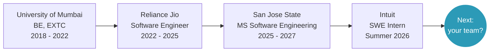
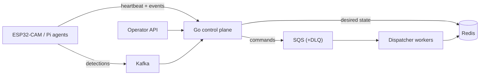

<div align="center">


<a href="https://github.com/sakshat-patil">
  
</a>

<br/>

<a href="https://www.linkedin.com/in/sakshat-patil"></a>
<a href="mailto:sakshatpatil25@gmail.com"></a>
<a href="https://sakshat-patil.github.io"></a>


</div>

---

### About me

```yaml
name:        Sakshat Patil
location:    San Jose, CA  (open to roles anywhere in the US)
education:   MS Software Engineering, San Jose State University   # 2025 - 2027
             BE Electronics & Telecommunications, University of Mumbai
experience:
  - Software Engineer Intern      @ Intuit         # Summer 2026
  - Software Engineer             @ Reliance Jio   # 2022 - 2025, backend for millions of users
  - Teaching Assistant            @ SJSU           # Business Systems Innovation Labs (Salesforce)
focus:       [backend, distributed systems, cloud infra, applied ML / LLMs]
looking_for: Software Engineering roles (new grad, entry-level, mid-level)
```

<details>
<summary><b>Where I've been</b> (click to expand)</summary>
<br/>



</details>

---

### Tech stack

<div align="center">

**Languages**<br/>


**Backend & Data**<br/>


**Cloud & DevOps**<br/>


**Frontend**<br/>


**ML / AI**<br/>


</div>

---

### Featured projects

> Click any project to open the details.

<details open>
<summary><b><a href="https://github.com/sakshat-patil/edgefleet">EdgeFleet</a></b> &nbsp;|&nbsp; IoT camera fleet control plane &nbsp;


</summary>
<br/>

A control plane for a fleet of edge cameras: remote config, **staged firmware rollouts with automatic rollback**, per-device health, and a Kafka pipeline for detection events.

- Rollouts release devices healthy-first in cumulative stages (5% -> 25% -> 100%), promote only after a soak period, and roll everything back if the failure rate crosses a threshold
- ESP32-CAM firmware with A/B OTA slots: a new image only becomes valid after its first good heartbeat, otherwise the bootloader reverts
- At-least-once command delivery via SQS + Redis with a dead-letter queue and CloudWatch alarm
- Raspberry Pi CV agent (OpenCV MOG2 + HOG person detection), VLAN-isolated edge networking
- Full AWS infra in Terraform (VPC, EKS, ElastiCache, SQS, ECR, S3, IRSA), Strimzi Kafka on Kubernetes, Prometheus metrics



</details>

<details>
<summary><b><a href="https://github.com/sakshat-patil/crewquarters">Crewquarters</a></b> &nbsp;|&nbsp; Your own local AI crew &nbsp;


</summary>
<br/>

A locally deployed AI-agent marketplace for NVIDIA GB10 (DGX Spark-class) machines. Install open-weight models, add agents from a curated catalog, run them in isolated containers, schedule them, and approve their actions from a web UI. Built with Nikhil Ghind and team.

- On-demand vLLM model loading with an admission controller that only co-locates models when the memory budget is safe
- Demo agents: a Twilio caller agent driven by Google Sheets, and a daily Gmail digest agent that classifies and summarizes mail with a local model
- One-command install for both `arm64` (DGX OS) and laptop dev paths, CI on every push

</details>

<details>
<summary><b><a href="https://github.com/sakshat-patil/Symptom-Based-Disease-Identification-via-RAG">Record-Based Medical Diagnostic Assistant</a></b> &nbsp;|&nbsp; Auditable clinical decision support &nbsp;


</summary>
<br/>

Given a patient's symptoms, ranks the most likely diseases and shows **why**: the FP-Growth association rule that fired plus the biomedical passages retrieved from MedQuAD. The goal is that every prediction is auditable, not just accurate.

- Hybrid ranking with a live alpha slider to blend association rules and retrieval
- `/suggest` endpoint predicts likely next symptoms; `/differential` writes a short differential across the top 3 candidates
- Next.js 14 front end with symptom autocomplete and clinical presets (CMPE 255, team of 3)

</details>

<details>
<summary><b><a href="https://github.com/sakshat-patil/272-Project">Supply Chain Risk Monitor</a></b> &nbsp;|&nbsp; Multi-agent incident response &nbsp;


</summary>
<br/>

Six specialized AI agents analyze supply-chain disruption events and produce incident response plans, turning days of manual risk assessment into a 15-30 second run.

- 0-100 risk scoring, financial impact estimates, and multi-tier supplier dependency analysis
- Real-time supplier health and weather monitoring, role-based auth, deployed on AWS (CMPE 272)

</details>

<details>
<summary><b><a href="https://github.com/sakshat-patil/GitTranslate">GitTranslate</a></b> &nbsp;|&nbsp; Hackathon: translate repos and podcasts &nbsp;


</summary>
<br/>

Browse any GitHub/GitLab repo and translate its comments, filenames and docs into another language. Bonus mode: transcribe a podcast with Whisper, translate it, and synthesize new audio. [Live demo](https://git-translate-indol.vercel.app) | [Devpost](https://devpost.com/software/gitcast)

</details>

<details>
<summary><b>More things I've built</b></summary>
<br/>

| Project | What it is | Stack |
|---|---|---|
| [MedAssist](https://github.com/sakshat-patil/MedAssist) | AI medical triage: risk levels from case notes and clinical docs, PDF reports, Twilio emergency alerts | React, TypeScript, FastAPI |
| [llm-local-inference-rayserve](https://github.com/sakshat-patil/llm-local-inference-rayserve) | Production-style local LLM server | vLLM, Ray Serve, FastAPI |
| [YOLOv8 training optimization](https://github.com/sakshat-patil/sakshat-patil-ultralytics) | Ablation study on detection training; +4.4% mAP@0.5:0.95 over baseline | PyTorch, Ultralytics |
| [scalable-microservices-assignment](https://github.com/sakshat-patil/scalable-microservices-assignment) | Two Flask services talking over HTTP | Python, Flask |
| [Serverless web app](https://github.com/sakshat-patil/Building-a-Serverless-Web-Application-with-AWS-Lambda-and-DynamoDB-Assignment) | Serverless CRUD app | AWS Lambda, DynamoDB |

</details>

---

### GitHub stats

<div align="center">


<picture>
  <source media="(prefers-color-scheme: dark)" srcset="https://raw.githubusercontent.com/sakshat-patil/sakshat-patil/output/github-contribution-grid-snake-dark.svg" />
  <source media="(prefers-color-scheme: light)" srcset="https://raw.githubusercontent.com/sakshat-patil/sakshat-patil/output/github-contribution-grid-snake.svg" />
  
</picture>

</div>

---

<div align="center">

**Currently:** finishing my MS at SJSU, grinding LeetCode, and building EdgeFleet.<br/>
**Ask me about:** distributed systems, Kafka, rolling out firmware without bricking things, RAG.<br/>
**Open to:** Software Engineering roles across the US. Say hi at [sakshatpatil25@gmail.com](mailto:sakshatpatil25@gmail.com).


</div>
